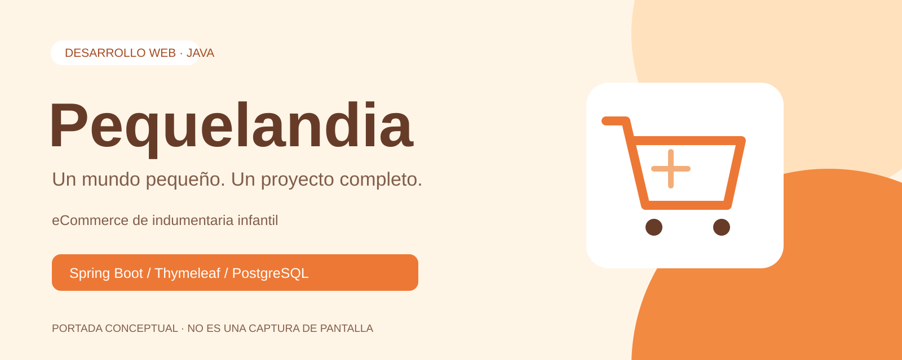

# Pequelandia

Aplicación web de comercio electrónico de indumentaria infantil que reúne catálogo, carrito, pedidos y herramientas de administración. Construida con Java y Spring Boot, utiliza vistas Thymeleaf y persistencia relacional con PostgreSQL.

> Proyecto en desarrollo. Las funcionalidades siguientes se identificaron mediante revisión del código; esto no equivale a una validación integral en ejecución. Las contraseñas de usuarios se mantienen sin hash por decisión de alcance: utilizar exclusivamente datos ficticios en demostraciones.

## Tecnologías

Java 22 · Maven Wrapper (Maven 3.9.11) · Spring Boot 3.5.4 · Spring MVC · Spring Data JPA/Hibernate · Bean Validation · PostgreSQL · Thymeleaf · Bootstrap 5.3.5 · JavaScript · Lombok · Apache POI (Excel) · OpenPDF (PDF) · JavaMailSender · springdoc OpenAPI.

## Funcionalidades y estado

| Área | Implementación identificada | Verificación pendiente |
| --- | --- | --- |
| Inicio y catálogo | Productos destacados, búsqueda, categoría, rango de precio, talle, orden y paginación | Navegación y resultados con datos ficticios |
| Carrito | Agregar, modificar cantidades, eliminar, finalizar y unión de carrito invitado al iniciar sesión | Flujo completo y concurrencia de stock |
| Cuentas | Registro, login por sesión, cierre de sesión y edición de perfil | Validación integral; contraseñas sin hash |
| Panel de usuario | Perfil, historial, pedidos y solicitudes de cancelación | Recorrido completo |
| Administración | Gestión de productos, usuarios y estados de pedidos | Pruebas completas de permisos y formularios |
| Estadísticas | Resumen, series por día/mes/año, productos más vendidos y stock bajo | Conciliación con pedidos de prueba |
| Exportaciones | Excel de entidades y estadísticas; PDF de pedido | Contenido y formato con datos ficticios |
| Notificaciones | Servicio persistente, listado, contador, lectura individual y total; campana en los paneles | Entrega de cada evento y permisos por destinatario |
| Correos | Bienvenida, avisos de registro/pedido, confirmación, cambios de estado y cancelación | Entrega SMTP real y recuperación ante fallos |

No se presenta como implementada una pasarela de pagos ni un despliegue de producción. El flujo de pedidos, stock, notificaciones y cola de correos tiene pruebas automatizadas contra PostgreSQL descartable y SMTP simulado. La entrega a buzones reales sigue pendiente de comprobación. Ver [cambios, configuración y pruebas](docs/NOTIFICACIONES.md).

## Arquitectura

Aplicación monolítica con MVC y servicios de negocio:

```text
Navegador → Controllers → Services → Repositories → PostgreSQL
                ↓            ↓
          Thymeleaf/JSON   SMTP / Excel / PDF
```

```text
.
├── pom.xml                     Dependencias y compilación
├── mvnw / mvnw.cmd              Maven Wrapper
├── compose.yaml                 PostgreSQL para desarrollo
├── application-example.properties
├── config/                      Configuración privada local, ignorada
├── docs/                        Guías y recursos visuales
└── src/
    ├── main/java/com/pequelandia/pequelandia/
    │   ├── config/              Controles de acceso MVC
    │   ├── controller/          Rutas HTTP
    │   ├── service/             Lógica de negocio
    │   ├── repository/          Acceso JPA
    │   ├── model/               Entidades
    │   ├── dto/                 Objetos de transferencia
    │   └── util/                Utilidades y carrito de sesión
    ├── main/resources/
    │   ├── application.properties
    │   ├── templates/           Vistas Thymeleaf
    │   └── static/              CSS, Bootstrap e imágenes
    └── test/                    Pruebas automatizadas
```

## Ejecución local

Requisitos: JDK 22, PostgreSQL accesible y acceso a Maven Central para descargar Maven/dependencias. Docker es opcional. Ejecutar los comandos desde la carpeta que contiene `pom.xml`.

```powershell
git clone https://github.com/ivanmolina1905/pequelandia-ecommerce.git
cd pequelandia-ecommerce
New-Item -ItemType Directory -Force config
Copy-Item application-example.properties config/application-local.properties
```

El comando de clonación estará disponible cuando se publique el repositorio. Editar el archivo local con una base **nueva, vacía y descartable** y sus credenciales. No compartir ese archivo.

El ejemplo utiliza `ddl-auto=update` exclusivamente para generar tablas en desarrollo. La configuración principal usa `validate`: requiere un esquema de negocio ya existente. El script aditivo `src/main/resources/db/notificaciones.sql` crea la cola de correo al arrancar, sin modificar datos existentes. Para probar registro y catálogo se necesitan localidades, categorías y productos ficticios. No importar backups de clientes. Configurar el ID administrativo mediante `PEQUELANDIA_ADMIN_ID`; con valor 0 se conserva la búsqueda de una única cuenta `admin` al iniciar. El ejemplo deja desactivada la entrega SMTP hasta configurar un servidor de pruebas.

También se pueden definir variables de entorno, sin archivo local:

| Variable | Uso |
| --- | --- |
| `PEQUELANDIA_DB_URL` | URL JDBC de PostgreSQL |
| `PEQUELANDIA_DB_USERNAME` | Usuario de PostgreSQL |
| `PEQUELANDIA_DB_PASSWORD` | Contraseña de PostgreSQL |
| `PEQUELANDIA_MAIL_HOST` / `PEQUELANDIA_MAIL_PORT` | Servidor SMTP (por defecto Gmail:587) |
| `PEQUELANDIA_MAIL_USERNAME` / `PEQUELANDIA_MAIL_PASSWORD` | Autenticación SMTP |
| `PEQUELANDIA_ADMIN_EMAIL` | Destinatario administrativo |
| `PEQUELANDIA_ADMIN_ID` | ID fijo de la cuenta administrativa |
| `PEQUELANDIA_MAIL_DELIVERY_ENABLED` | Habilita el worker SMTP; `false` conserva mensajes en cola |

El archivo local importado tiene prioridad sobre estos valores. Spring Boot no carga automáticamente archivos `.env`. Docker Compose sí puede utilizarlos para interpolar sus variables; su URL JDBC se configura por separado.

```powershell
# Opcional: con PEQUELANDIA_DB_USERNAME y PEQUELANDIA_DB_PASSWORD definidos
docker compose up -d
# Compilar y ejecutar
.\mvnw.cmd clean compile
.\mvnw.cmd spring-boot:run
```

En Linux/macOS: `chmod +x mvnw` y `./mvnw spring-boot:run`. Abrir `http://localhost:8080/`, `/productos`, `/auth/registro` o `/auth/login`. Para un SMTP de pruebas local usar el ejemplo; nunca usar direcciones reales en una demostración. Los tests de integración requieren `PEQUELANDIA_TEST_DB_URL` apuntando a una base local descartable `pequelandia_verificacion`; sin esa variable se omiten y se ejecutan los unitarios. Ver [instrucciones y resultados de pruebas](docs/NOTIFICACIONES.md#pruebas-reproducibles).

## Presentación visual

La portada es una ilustración editorial SVG en crema, naranja y blanco; **no es una captura de la aplicación**. Ver el [plan de capturas](docs/images/README.md). Las siete pantallas tienen su espacio documentado y se añadirán cuando puedan verificarse con datos ficticios. No se incluyen capturas con datos de clientes ni mockups presentados como funciones reales.

## Seguridad y límites actuales

La configuración privada y los archivos compilados, bases, backups, logs y exportaciones están excluidos de Git. Se añadieron controles de sesión para administración, exportaciones, paneles y pedidos; el acceso a pedidos requiere titularidad o administración. Las contraseñas se excluyen de la serialización JSON. El login renueva el identificador de sesión.

Las contraseñas siguen almacenándose sin hash por la instrucción vigente de mantenimiento. La administración se autoriza por ID y las operaciones POST están protegidas con CSRF. Quedan pendientes los límites de intentos, un sistema de múltiples roles y una revisión integral de seguridad antes de un uso con clientes. Estos controles no sustituyen una auditoría de seguridad. Ver [seguridad](docs/SEGURIDAD.md).

## Próximas mejoras

- Migraciones de base de datos y datos de demostración reproducibles.
- Extender las pruebas a recorridos visuales completos y sesiones distribuidas.
- Administración de múltiples roles y límites de intentos.
- Verificar la entrega SMTP real y definir la retención de mensajes enviados.
- Validación responsive con capturas de escritorio y móvil.
- Integración de pagos, si se incorpora al alcance.

## Desarrollo y mantenimiento

Usar ramas para cambios importantes y mantener `main` estable. Mensajes sugeridos: `feat: implementar notificaciones de pedidos`, `fix: corregir devolución de stock`, `docs: actualizar documentación`. Cada funcionalidad debe verificarse antes de preparar su commit. Avisar y proponer el push; no publicar automáticamente cambios futuros.

Ver [flujo de trabajo](docs/CONTRIBUIR.md). Autor y licencia del proyecto pendientes de confirmación; se conservan los avisos de terceros existentes.
